<p align="center">
  
</p>

<p align="center">
  <a href="https://gereme.gajec.org"><b>🌐 Portfolio</b></a>
  &nbsp;&nbsp;·&nbsp;&nbsp;
  <a href="https://linkedin.com/in/gereme-marcus-garcia"><b>💼 LinkedIn</b></a>
  &nbsp;&nbsp;·&nbsp;&nbsp;
  <a href="https://github.com/GeremeGarcia?tab=repositories"><b>📦 Repositories</b></a>
</p>

---

### 👋 Hey, I'm Gereme

I'm a **Computer Science student** who likes knowing *why* things work, not just *that* they work.
Most of my time goes into backend systems, application architecture, and lately AI: how to build
software that holds up once real people start using it.

```java
public class Gereme extends Student implements Engineer {

    String   role      = "Computer Science Student";
    String[] interests = { "Backend", "Software Architecture", "APIs", "Databases", "AI", "Distributed Systems" };
    String   motto     = "Learn continuously. Build thoughtfully. Engineer purposefully.";

    @Override
    public Software build(Idea idea) {
        return idea.understand()      // figure out the real problem first
                   .design()          // simple beats clever
                   .ship()            // done is a feature
                   .iterate();        // then make it better
    }
}
```

---

### 🧰 Tech Stack

<p align="center">
  
</p>

---

### 🚀 What I'm Building

<table>
<tr>
<td width="50%" valign="top">

#### 🏥 MediSync AI
An AI-assisted healthcare platform for **patient intake, urgency triage, and clinical workflow coordination**, built on multimodal AI.

`Python` `FastAPI` `React` `MySQL` `AI/ML`

</td>
<td width="50%" valign="top">

#### 🌐 Full-Stack Web Apps
End-to-end web applications: modern frontends, backend services, API integrations, and relational databases tied together.

`React` `Node.js` `Fastify` `PostgreSQL`

</td>
</tr>
<tr>
<td width="50%" valign="top">

#### ☕ Java Development
Desktop apps, client-server communication, and build automation, plus a lot of object-oriented design.

`Java` `JavaFX` `Swing` `Maven` `Ant`

</td>
<td width="50%" valign="top">

#### 🔬 Engineering & Research
Algorithms, networking, system design, and the theory behind practical computer science.

`Algorithms` `Networking` `AI/ML` `System Design`

</td>
</tr>
</table>

<p align="center"><a href="https://github.com/GeremeGarcia?tab=repositories"><b>→ Browse all repositories</b></a></p>

---

### 📚 Currently Leveling Up

| 🏗️ Software Engineering | 🧠 Computer Science |
| :-- | :-- |
| Software architecture & design patterns | Database optimization |
| Clean, maintainable code | Distributed systems |
| REST API design | Artificial intelligence |
| Testing & reliability | Computer networking |

<details>
<summary><b>⚡ A few quick facts</b></summary>
<br />

- 🔍 I'd rather read the source than guess at the docs
- 🧩 Favorite kind of problem: making a messy system simple
- 🛠️ Every project starts as "how hard could it be?"
- 🌱 Always open to learning from people who know more than I do

</details>

---

### 🤝 Let's Connect

I'm always up for technical conversations, learning opportunities, and building something meaningful together.
The best place to start is my **[portfolio](https://gereme.gajec.org)** or a message on **[LinkedIn](https://linkedin.com/in/gereme-marcus-garcia)**.

<p align="center">
  <i>"Curiosity, consistency, and thoughtful engineering turn ideas into useful software."</i>
</p>

<p align="center">
  
</p>
